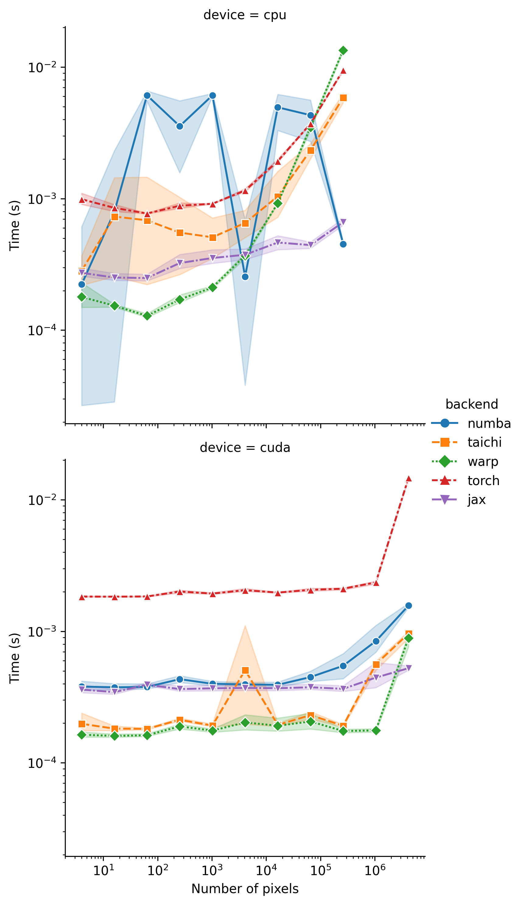
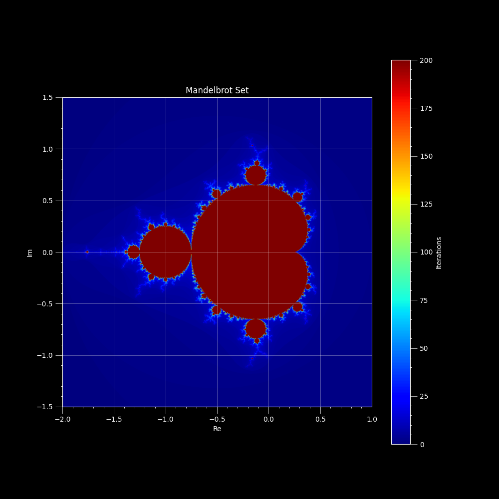

# mandelbrot-benchmark

<p align="center">
  <a href="https://github.com/34j/mandelbrot-benchmark/actions/workflows/ci.yml?query=branch%3Amain">
    
  </a>
  <a href="https://mandelbrot-benchmark.readthedocs.io">
    
  </a>
</p>
<p align="center">
  <a href="https://codecov.io/gh/34j/mandelbrot-benchmark">
    
  </a>
  <a href="https://github.com/astral-sh/uv">
    
  </a>
  <a href="https://github.com/astral-sh/ruff">
    
  </a>
  <a href="https://github.com/j178/prek">
    
  </a>
</p>
<p align="center">
  <a href="https://pypi.org/project/mandelbrot-benchmark/">
    
  </a>
  
  
</p>

---

**Documentation**: <a href="https://mandelbrot-benchmark.readthedocs.io" target="_blank">https://mandelbrot-benchmark.readthedocs.io </a>

**Source Code**: <a href="https://github.com/34j/mandelbrot-benchmark" target="_blank">https://github.com/34j/mandelbrot-benchmark </a>

---

Benchmark Numba, Taichi, Warp, CuPy Kernel, Triton using Mandelbrot set

## Results

- 200 iterations max
- $c \in [-2, 1] \times [-1.5, 1.5]$
- JAX version is quite hacky ("vectorized")
- `JAX` version is omitted because it makes the benchmark unstable (see previous release for the comparison)
- AMD Ryzen 9 3950X + NVIDIA GeForce RTX 4070 SUPER



- The results are almost identical when `device = cuda`
- The computation time for `Numba` is quite unstable



## Some notes

- In `Numba`, the type of variables needs to be explicitly specified to use `float32` instead of `float64` (default), while is not the case for `Taichi`, `Warp`.

## Installation

Install this via pip (or your favourite package manager):

```shell
pipx install mandelbrot-benchmark
```

## Usage

Run the benchmark and plot the results:

```shell
mandelbrot-benchmark benchmark
mandelbrot-benchmark plot
```

## Alternatives

- [YanagiAyame/python-mandelbrot-benchmark: Which is better, Numba, Taichi, Warp or JAX?](https://github.com/YanagiAyame/python-mandelbrot-benchmark)
- [mandelbrot-on-all-accelerators.ipynb](https://gist.github.com/jpivarski/da343abd8024834ee8c5aaba691aafc7)
